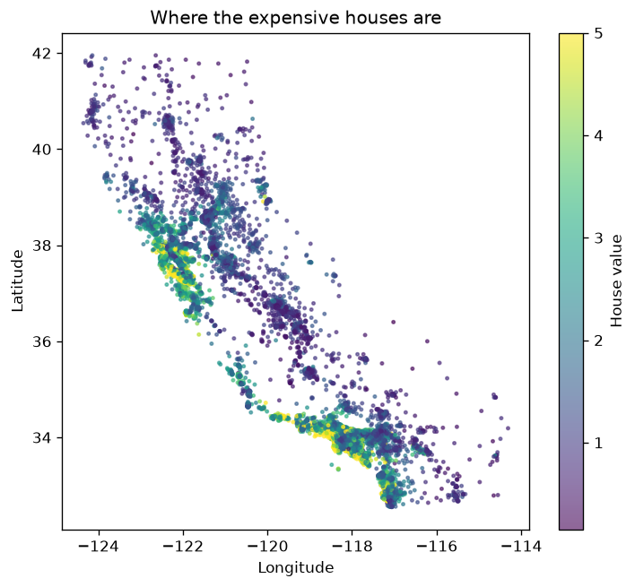
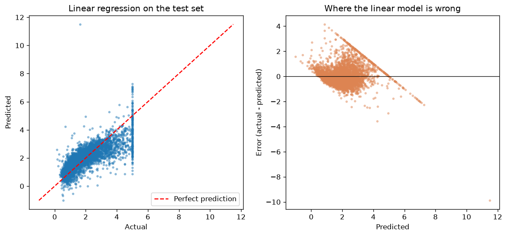
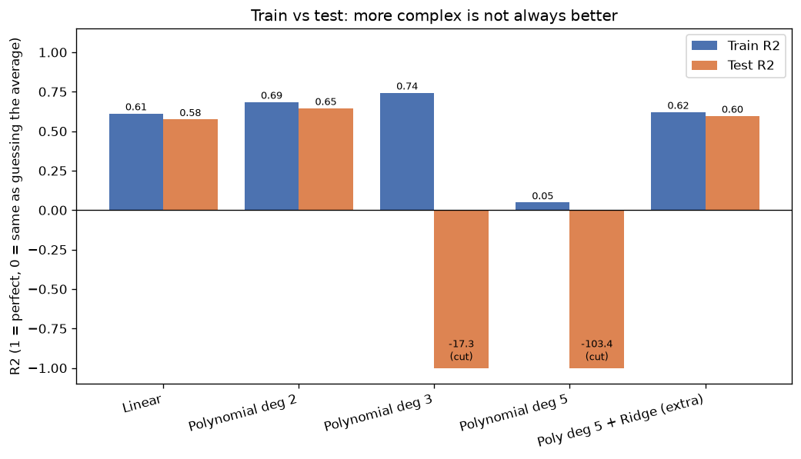

# 🏠 California Housing Price Prediction: Regression Project

A regression project that predicts the median house value of California districts. It compares linear and polynomial regression against a naive baseline, uses cross-validation on training data only to pick the model, and shows clearly **why more complex models are not always better**.

## 📌 Overview
| | |
|---|---|
| **Dataset** | California Housing (1990 census): 20,640 districts, 8 features |
| **Target** | Median house value (in $100,000s) |
| **Tools** | Python, pandas, NumPy, scikit-learn, Matplotlib, Seaborn, joblib |
| **Split** | 80% train (16,512) / 20% test (4,128) |

## 🔍 Workflow
1. Load and inspect the data; explore distributions, correlations, and a geographic map of prices.
2. Set a **baseline** that always predicts the average price.
3. Train **linear regression**, then **polynomial regression** (degree 2, 3, and 5).
4. Add **degree-5 polynomial + Ridge** regularization as a fix for overfitting.
5. Select the model with **5-fold cross-validation on the training set only**, then evaluate **once** on the untouched test set.

## 📊 Results (test set)
| Model | CV R² (train) | Test R² | Test MAE |
|---|---|---|---|
| Baseline (predict the mean) | — | 0.00 | $90,600 |
| **Linear regression** ✅ | **0.61** | **0.58** | **$53,300** |
| Polynomial, degree 2 | −1.88 | 0.65 | $46,700 |
| Polynomial, degree 3 | very unstable | −17.3 | $53,300 |
| Polynomial, degree 5 | very unstable | −103.4 | $106,700 |
| Polynomial deg 5 + Ridge | −206.5 | 0.60 | $52,700 |

**Selected model:** plain linear regression. It explains **57.6%** of price variation on unseen data, with a mean error of about **$53,300** versus **$90,600** for the baseline.

**Why not degree 2?** It scored better on this particular test set, but its cross-validation score was very poor, which means it was unstable across folds. Picking it because of its test score would be using the test set to choose the model. The selection rule was set in advance: the best **CV** score wins.

**Key insight:** median income (`MedInc`) is the strongest driver of price (correlation 0.69), and location (latitude/longitude) matters a lot too.

<p align="center">
  
  
</p>
<p align="center">
  
</p>

## ▶️ How to Run
```bash
pip install numpy pandas scikit-learn scipy matplotlib seaborn joblib
python housing_all_in_one.py
```
The first run downloads the dataset through scikit-learn (internet needed once). You can also predict a custom district:
```bash
python housing_all_in_one.py --set MedInc=5 --set HouseAge=20 --set Latitude=34
```

## 📁 Project Structure
```
├── housing_all_in_one.py   # Full project in one script
├── outputs/
│   ├── figures/            # Charts
│   └── results.json        # All metrics
└── reports/
    └── California_Housing_Report.pdf
```

## 👤 Author
**Waseem Mahmoud** · [LinkedIn](https://www.linkedin.com/in/waseem-mahmoud-a34154213) · [GitHub](https://github.com/waseemalali)
